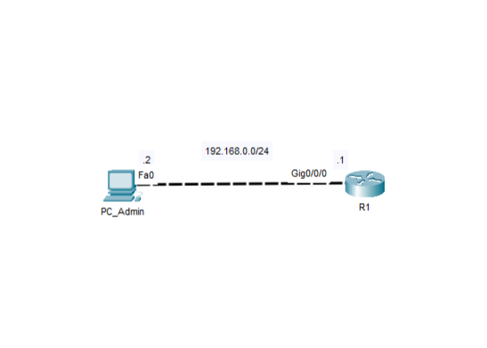

# Lab 01 - Configurazione iniziale di un dispositivo Cisco

[Complete Lab 01 - Initial Cisco Device Configuration.ptk](Complete%20Lab%2001%20-%20Initial%20Cisco%20Device%20Configuration.pkt)

**N.B.** Cisco Packet Tracer è necessario per aprire questo laboratorio.

## Obiettivo
Eseguire la configurazione iniziale di un dispositivo Cisco impostando l'hostname, implementando le impostazioni di sicurezza di base e configurando un banner di accesso.

Realizzare una rete IPv4 con prefisso /24 assegnando gli indirizzi IP al router e all'host, configurando il gateway predefinito dell'host e verificando la connettività tra i dispositivi.

## Topologia

## Tecnologie
- Dispositivi Cisco
- Cisco IOS
- Configurazione iniziale
- IPv4

## Verifica
- show running-config
- show startup-config
- show ip interface brief
- Ping da PC_admin a R1

## Concetti appresi
Questo laboratorio rafforza l'importanza di eseguire una corretta configurazione iniziale prima di distribuire un dispositivo Cisco in una rete.

Un dispositivo configurato correttamente è più facile da gestire, più sicuro e pronto per implementazioni future.

