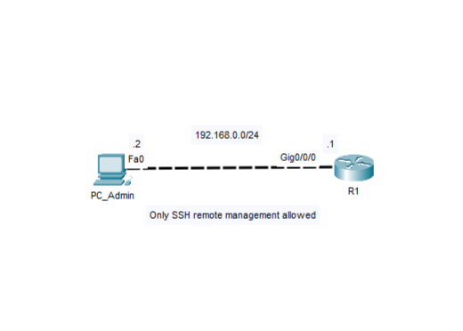

# Lab 02 - Gestione remota sicura dei dispositivi

[Complete Lab 02 - Secure Remote Device Management.ptk](Complete%20Lab%2002%20-%20Secure%20Remote%20Device%20Management.pkt) "N.B. Cisco Packet Tracer è necessario per aprire questo laboratorio"

## Obiettivo
Configurare un dispositivo Cisco per l'amministrazione remota sicura implementando l'autenticazione locale degli utenti e la connettività SSH.

#### Prerequisiti
- Lab01 - Initial Cisco Device Configuration

## Topologia

## Tecnologie
- Dispositivi Cisco
- Cisco IOS
- Amministrazione remota sicura
- IPv4

## Verifica
- show running-config
- show startup-config
- show ip ssh
- Connessione SSH da PC_Admin
- Verificare che l'accesso Telnet sia disabilitato

## Concetti appresi
Questo laboratorio rafforza l'importanza di proteggere l'accesso remoto a un dispositivo Cisco. L'implementazione dell'autenticazione locale e di SSH migliora la sicurezza amministrativa proteggendo le sessioni di gestione e impedendo gli accessi non autorizzati.
