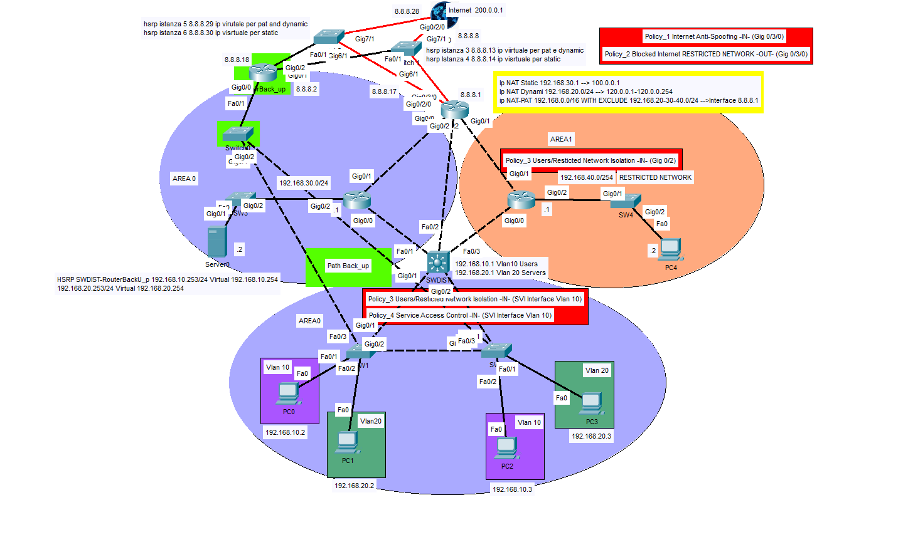
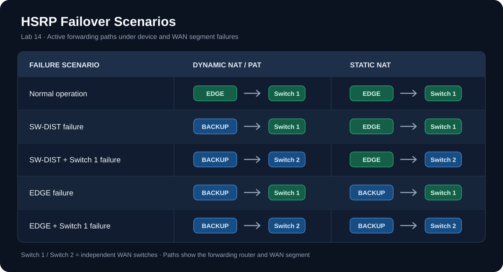

# Lab14 - HRSP First-Hop Redundancy

## Objective 
Implement a network redundancy system using HSRP (Hot Standby Router Protocol), with the objective of eliminating single points of failure (SPOFs) associated with the Edge and distribution gateways.

The lab involves integrating redundancy into an existing infrastructure based on the OSPF routing protocol, preserving its original architecture as much as possible.

Redundancy is implemented through the coordination of HSRP, interface tracking, OSPF, and static routing to manage failover of the distribution gateways and the Edge router.

The solution is designed to enable the restoration of connectivity through alternative paths in the event of single or multiple device failures, within the scenarios covered by the lab.

### Design Note
The original infrastructure was based on routers interconnected through point-to-point links and the OSPF routing protocol, which provided alternative paths within the network. However, the Layer 3 switch SW-DIST, responsible for inter-VLAN routing, and the R2 Edge router, responsible for external connectivity and NAT functions, represented two single points of failure (SPOFs).

To introduce redundancy at both levels while preserving the existing architecture as much as possible, a backup router configured in Router-on-a-Stick mode was added. Through an additional Layer 2 switch and an IEEE 802.1Q trunk link, the backup router participates in the HSRP groups for VLANs 10 and 20, assuming the Active role and taking over forwarding through the respective virtual gateways if SW-DIST becomes unavailable.

On the WAN side, the original architecture included a point-to-point link between the WEB router and the Edge router. To implement HSRP redundancy at this level as well, the link was replaced with a multiaccess network using a Layer 2 switch, creating a shared broadcast domain between WEB, Edge, and the backup router.

However, introducing a single switch would have created a new single point of failure on the WAN side. To eliminate this dependency, a second independent multiaccess network was implemented using an additional Layer 2 switch, providing an alternative WAN path in case the first segment becomes unavailable.

The solution uses a total of six HSRP groups: two dedicated to the virtual gateways of VLANs 10 and 20, and four distributed across the two WAN segments. Each WAN broadcast domain contains two HSRP groups with distinct virtual IP addresses, independently used by the WEB router as next hops to reach the public IP addresses associated with static NAT and dynamic NAT/PAT, respectively.

This separation allows different priorities and interface tracking mechanisms to be configured, enabling independent selection of the HSRP Active router for the two traffic categories. For example, if SW-DIST fails, the backup router assumes the Active role for the groups dedicated to dynamic NAT/PAT, while R2 Edge remains Active for the groups associated with the server's static NAT, as long as it remains operational.

The coordination of HSRP, OSPF, and static routing manages path selection. On the WEB router, primary and floating static routes were configured with next hops corresponding to the HSRP virtual IP addresses of the respective WAN segments, allowing failover to the alternative WAN link. Within the internal network, since both Edge and the backup router can advertise a default route through OSPF, static routes with an administrative distance of 105 were configured on selected devices to prefer the path through Edge over OSPF routes with an administrative distance of 110.

The public IP addresses used for NAT translations are kept independent of the WAN transit subnets, allowing them to remain reachable through either WAN segment without changing the translated addresses during failover.

The solution still has some limitations. Dynamic NAT sessions are not synchronized between Edge and the backup router and may therefore be interrupted during failover, requiring new connections to be established. Additionally, failure detection based on interface status and route availability does not guarantee coverage of every possible partial connectivity failure, especially when interfaces remain operational.

#### Prerequisites 
Lab13 - IPv4 Address Translation - (NAT-PAT)
## Topology

## Technologies
- Cisco Devices
- Cisco IOS
- IPv4
- HRSP
- OSPF
- Static Route
- Static NAT
- Dynamic NAT
- NAT Overload/PAT
- Named Standard ACLs for NAT Classification
  
## Verification
- show running-config
- show startup-config
- show ip access-list
- show ip interface
- show ip nat translations
- show ip nat statistics
- show standby brief
- Tracert
- Generate traffic across NAT boundary to verify translation (ping)

  
## Key Takeaways
This lab highlighted the fundamental role of HSRP and other First-Hop Redundancy Protocols (FHRPs) in maintaining network connectivity when a default gateway becomes unavailable.

It also demonstrated how network redundancy depends not only on individual protocols, but on their effective coordination. By combining HSRP, interface tracking, OSPF, and static routing, it was possible to define specific failover behaviors for different network failure scenarios.

A key takeaway was the ability to influence traffic paths through careful configuration of routing preferences, HSRP priorities, and tracking mechanisms, allowing the network to respond to failures according to the intended design.

Testing single and multiple device failures was essential to validate the solution, identify potential weaknesses, and verify that alternative paths were actually used as expected.

A more advanced implementation using IP SLA, combined with object tracking, could further improve failure detection by monitoring actual network reachability rather than relying primarily on interface status and routing information, enabling more precise failover decisions.
